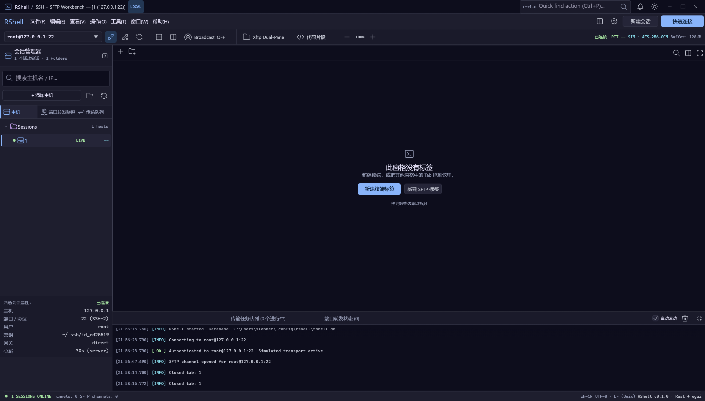

# RShell

RShell 是一个基于 Rust + egui 的跨平台 SSH / SFTP / WSL / RDP 工作台。界面采用高密度运维工作台布局，终端、远程桌面与双栏 Xftp 文件管理都作为同级 Tab 内容存在。

当前版本已经接入真实 SSH/SFTP、Windows WSL 本地终端和 RDP 远程桌面：终端使用 VT100 屏幕缓冲呈现输出，SFTP 使用真实的远端目录、上传、下载、编辑、chmod 与 MD5 校验流程，RDP 使用 IronRDP 帧缓冲渲染。



堡垒机（深信服 TUI 菜单）会话的冻结设计见 [docs/bastion-design.md](docs/bastion-design.md)。

## 已实现

- 无边框桌面窗口、应用内菜单栏、快捷键与窗口缩放控制
- 中英文界面，默认跟随系统语言
- 系统 UI 字体与等宽字体枚举、选择与即时预览，无内嵌字体
- Tabler SVG 矢量图标，运行期着色
- 递归主机目录树、主机连接状态与活动会话属性
- 主机连接信息编辑，支持改名、改地址/端口、切换认证方式与移动目录
- 主机与文件夹可在递归目录树中拖拽移动
- 侧栏搜索按需展开，标题栏提供设置与配色入口
- 真实 SSH 终端 / SFTP 同级标签
- SSH 连接后静默识别 Linux 发行版或 Windows，并更新、持久化主机树图标
- WSL 本地 Shell（Windows ConPTY，可选择发行版）
- RDP 远程桌面（IronRDP、每个连接独立初始分辨率、远端桌面全屏、基础鼠标/键盘输入）
- SSH 密码、RShell 托管私钥、文件系统私钥与 OpenSSH Agent 认证
- SSH 主机密钥 TOFU 校验，指纹持久化到 SQLite
- VT100 终端解析、ANSI 颜色、滚动回看、PTY resize 与直接键盘输入
- 终端配色主题（RShell Dark、Solarized Dark、Dracula、Paper）
- 真实 SFTP 双栏浏览、上传/下载进度、远端编辑、chmod 与 MD5
- SFTP 本地/远端正栏路径可直接编辑并按回车跳转
- 递归分栏树、可拖拽分隔条、Tab 拖拽到窗格四边拆分
- 直接编辑、chmod、MD5 面板
- 可折叠日志 / 传输 / 隧道控制台
- SQLite 持久化主机树与设置
- 可选软件密码、Argon2id 密钥派生、ChaCha20-Poly1305 字段加密
- 系统凭据库自动解锁，支持记住一周、一月或永久
- RShell 托管私钥导入与加密存储；Key 认证可选择托管密钥或文件系统路径
- 忘记密码时保留主机名称、IP 与层级，清除身份凭据
- 自定义 TOML 配置与开发专用固定数据库

## 构建

要求 Rust 1.99.1 或更新版本，以及 Windows MSVC 构建环境。SQLite 由 `rusqlite` 的 `bundled` 特性随应用编译。

```powershell
cargo test
cargo build --release --bin rshell
```

Windows 可执行文件位于：

```text
target\release\rshell.exe
```

## 模块结构

应用编排已按行为域拆分，`app/mod.rs` 只保留状态结构与 eframe 生命周期：

```text
src/app/
  bootstrap.rs       启动、数据库、字体、自动解锁
  queries.rs         只读查询、日志、主题与字体切换
  sessions.rs        主机、连接、标签、分栏
  terminal_ops.rs    终端命令与广播
  transfers.rs       SFTP 传输队列
  file_actions.rs    编辑、chmod、MD5
  security_flow.rs   密码、锁定与凭据重置
  persistence.rs     主机树与设置持久化
  runtime.rs         帧更新与快捷键
  state.rs           应用层 UI 状态与草稿

src/ui/
  shell/             标题栏、菜单、快捷栏、状态栏
  sidebar/           主机树、隧道/队列面板、属性检查器
  workspace/         递归分栏、标签栏、空窗格与拖放预览
  sftp/              SFTP 双栏浏览、文件表格与工具栏
  dialogs/           统一紧凑标题栏、设置、安全、主机、文件工具与命令面板

src/ssh/
  mod.rs             异步 SSH/SFTP worker、WSL ConPTY worker、认证、终端通道、传输与主机密钥校验

src/rdp/
  mod.rs             IronRDP 连接、帧缓冲缓存、RDP 输入事件

src/domain/
  host.rs            主机与递归目录树
  workspace.rs       分栏树与标签移动
  terminal.rs        终端标签与输出
  transfer.rs        传输、隧道、日志与文件条目
  settings.rs        主题、语言和持久化设置

src/local_fs.rs      本地目录、文件预览与写入
```

## 数据与配置

默认数据目录：

```text
~/.config/rshell/
```

配置文件查找顺序：

1. `RSHELL_CONFIG` 环境变量
2. 可执行文件旁的 `config.toml`
3. `~/.config/rshell/config.toml`
4. 无配置时使用 `~/.config/rshell/rshell.db`

配置示例：

```toml
[storage]
database = "~/.config/rshell/rshell.db"
```

相对数据库路径以配置文件所在目录为基准，支持 `~` 与绝对路径。

## 调试

开发和真实主机联调统一使用默认数据库：

```text
~/.config/rshell/rshell.db
```

Debug 构建还支持直接打开视觉测试场景：

```powershell
$env:RSHELL_DEBUG_SCENE = "sftp"   # terminal | sftp | split
```

生产启动不会自动写入任何演示主机或标签。

## 安全模型

- 主机名称、IP、端口和目录层级保持明文，便于忘记密码后仍保留服务器目录。
- 用户名、密码、密钥引用等敏感字段使用 ChaCha20-Poly1305 加密。
- RShell 托管的 SSH 私钥内容同样使用 ChaCha20-Poly1305 加密；文件系统密钥只保存路径引用，不纳入 RShell 的加密保护。
- SSH 服务端主机密钥使用首次信任（TOFU）并记录 SHA-256 指纹；后续指纹不一致会拒绝连接。
- 软件密码经 Argon2id 派生后封装数据密钥，应用只保存封装结果。
- 自动解锁密钥存放在操作系统凭据库，不随 SQLite 数据库迁移。
- 迁移到新机器后，即使曾选择“永久记住”，首次打开仍要求输入软件密码。

## 当前范围

真实 SSH/SFTP 已完成第一版纵向切片。当前仍不包含：

- Jump host / ProxyJump、端口转发隧道与断线自动重连
- 带口令私钥的解锁提示
- Windows/macOS 任务栏进度联动、安装器与自动更新

RDP 使用独立的 IronRDP 连接器，后续还需要补齐剪贴板、动态尺寸协商、远程指针位图和音频等桌面能力。旧数据库中的 PSRP 主机会在加载时迁移为 RDP。

## 依赖

`eframe 0.37`、`egui_extras 0.37`、`fontdb`、`rusqlite`、`rfd`、`argon2`、`chacha20poly1305`、`keyring`、`getrandom`、`chrono`、`serde`、`toml`、`tokio`、`russh`、`russh-sftp`、`portable-pty`、`ironrdp-client`、`ironrdp-pdu`、`smallvec`、`vt100`。

常规界面图标来自 [Tabler Icons](https://github.com/tabler/tabler-icons)，使用 MIT License；操作系统品牌图标来自 Simple Icons（CC0）。许可证和来源说明位于 `assets/icons/`。

